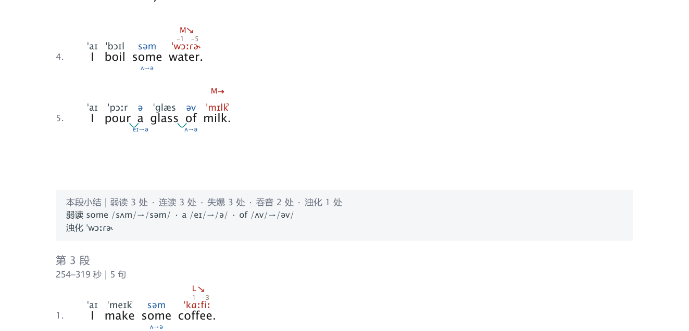
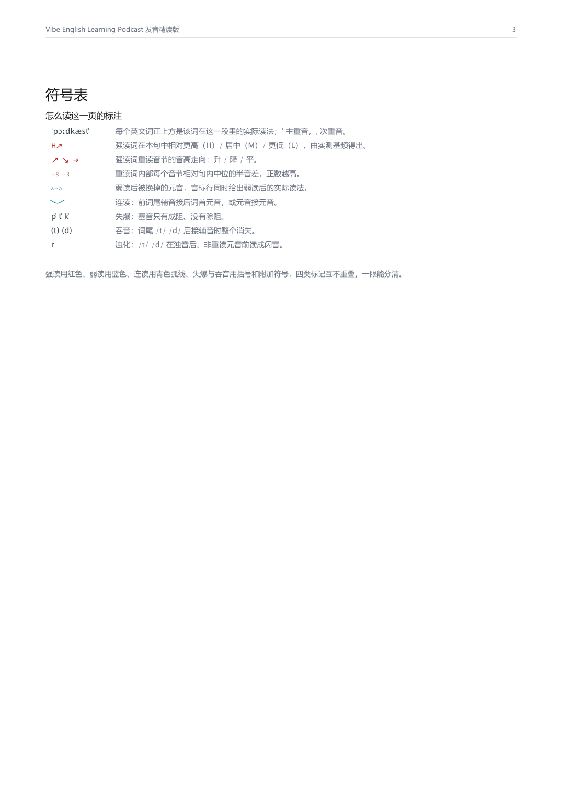

# ipa-study

把一段英文音频做成**逐词行间注的发音精读 PDF**。

每个英文词上方是它在这段录音里的实际读法，音标上方是实测音高（H/M/L 与音节半音差），
下方是弱读时被换掉的元音，词间弧线是连读，括号和附加符号是吞音、失爆、浊化。



<sub>`I boil some water.` 里 `boil` 被抬起来且音调下行；`some` 弱读成 /sʌm/→/səm/；
`I pour a glass of milk.` 里三处弱读、两处连读。</sub>

它同时是一个 [Claude Code](https://claude.com/claude-code) skill：装到
`~/.claude/skills/` 之后，任何能跑 Python 的 agent 读完 `SKILL.md` 就能接手，
给它音频（可选外加文案）即可产出同款产品。

## 产出什么

- **逐词标注**：音标、强读、音节音高、相对高低、语调走向、弱读元音变化、
  连读、重音位置、失爆、吞音、/t/ 浊化 —— 共十一项
- **音高查询表**：把半音数字翻译成"听起来是什么感觉"，附真实波形
- **分节结构**：长片自动分成 3–14 节，每节有标题、承接句和回原文才能答的问题
- **段落小结**：每 5 句报一次弱读/连读/失爆/吞音/浊化各几处



## 安装

```bash
pip install -r requirements.txt
```

还需要系统里有 `ffmpeg`。字体：Windows 自带字体即可；macOS / Linux 见
[`references/rendering.md`](references/rendering.md)，缺字会直接报错而不是画出方框。

装成 Claude Code skill：

```bash
# Windows
New-Item -ItemType Junction -Path "$env:USERPROFILE\.claude\skills\ipa-study" -Target "$PWD"
# macOS / Linux
ln -s "$PWD" ~/.claude/skills/ipa-study
```

## 用

```bash
ipa init --audio 素材.mp3 --out job.json    # 探测时长，自动选形态
ipa run job.json                             # 跑到第一个需要你决定的地方
```

转写完成后先体检一次，它决定后面所有事的方向：

```bash
ipa profile job.json --apply
```

```
素材形态：shadowing —— 影子跟读：每句念若干遍，句间留出跟读时间
  语速 56 词/分 · 有声 52% · 304 条 · 重复 90%
  已写回：asr.dedupe.enabled = True    asr.gapfill.enabled = False
          asr.itemwise.enabled = True  segment.paragraph_gap_sec = 9999.0
```

`run` 会在四个地方停下来等人做判断，**这是设计好的**，不是失败：

| 闸门 | 为什么停 |
|---|---|
| 分章 | 算法只看得见停顿，读不懂内容 |
| 断句 | 粘词和超长句是出错信号 |
| 词典 | 未解析专名会静默读成 `/ˈʌn/`，成品上看不出来 |
| 章节文案 | 标题对但问题是套话，产品就空了 |

先出样张，确认版式再出全书：

```bash
ipa render job.json --chapters 1 --out 样张.pdf
```

## 这个项目真正想留下的东西

代码是其次。三件事才是：

**1. 判断。** 十一项标注里，音高、重读、时长是**声学事实**，必须实测；弱读、连读、
失爆、吞音、浊化是**规则判定**；音节内配时对不上时是**插值**。这条分界线写进成品首页——
读者分不清哪些是测的，整个产品就失去可信度。见 [`references/annotation.md`](references/annotation.md)。

**2. 规程。** 十二个阶段各自的输入输出、断点条件、退出码。章节时间只存在
`job.chapters[].start/end` 一处——早期版本把它抄在六个地方且互不相等，换素材必出串章。

**3. 素材形态。** 同一条流水线遇到"每句念两遍、句间留白五秒"的影子跟读材料时，
会连着做错四件事。`ipa profile` 就是为了在三十秒内识别出来，而不是让人花四十分钟。
见 [`references/material-shape.md`](references/material-shape.md)。

## 验证过什么

**叙事型**（66 分钟纪录片，有文稿）：100 页、零缺字，与金标准逐页一致；
对齐逐词误差 2ms 内；弱读 100% 复现，连读/吞音/浊化 Jaccard ≥0.99，强读 0.989。

**跟读型**（68 分钟播客，只有音频、无文案）：45 页、314 句 / 2,242 词，
未匹配 0.04%，零缺字，`ipa qa` 通过。

```bash
python tests/test_golden.py    # 15 项
```

**没有验证的**：ASR 本身的听错没有逐句人耳核对。314 句里自动能修的边界错位都修了，
剩下的听岔（连读处合并、个别词听错）需要对着音频核。

## 仓库结构

```
SKILL.md              入口（100 行），决定什么时候读哪份文档
references/           10 份说明书
ipa_study/            28 个模块：CLI、各阶段、排版引擎
examples/steve-jobs/  回归测试夹具（仅第 1 章）
tests/                15 项测试
docs/                 README 用图
```

## 关于示例数据

`examples/steve-jobs/` 只保留第 1 章的标注（约 850 词的转写与音标），用作回归测试夹具。
整部纪录片的逐字转写没有放进仓库——那是受版权保护的内容。

## License

MIT，见 [LICENSE](LICENSE)。
